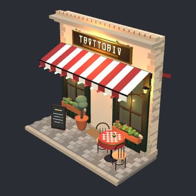
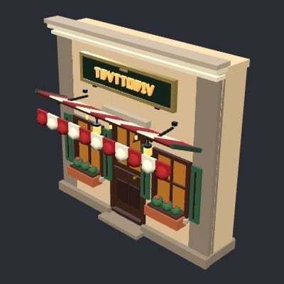

# 3JSBench

3JSBench evaluates LLMs on procedural text-to-3D generation of [Three.js](https://github.com/mrdoob/three.js) objects. Each task is a short brief, such as:

> a cozy italian restaurant storefront with the restaurant's name on the sign above the door, warm lit letters over a striped awning

| | GPT-6 Astra | Gemini 3.8 Flash | Grok 4.6 |
| :--- | :---: | :---: | :---: |
| |  |  |  |
| Restaurant name is readable | ✓ | ✗ | ✗ |
| Awning is level or slopes down outward | ✓ | ✓ | ✗ |
| Awning is connected | ✓ | ✗ | ✗ |
| Sign touches the building facade | ✓ | ✓ | ✓ |
| Awning and sign don't intersect | ✓ | ✓ | ✓ |
| No flickering surfaces | ✓ | ✗ | ✗ |
| **Result** | **Pass** (16/16) | **Fail** (11/16) | **Fail** (12/16) |

Website: [3jsbench.com](https://3jsbench.com)

This repository holds the 100 tasks and the code that generates attempts. We
will release the full benchmark soon, including the grader that renders each
attempt, maps its parts and runs the checks.

- `tasks/<name>/prompt.md`: the brief.
- [`src/`](src/) and [`tools/3jsbench.js`](tools/3jsbench.js): generation.

## Generate

Requires Node 22.12+. There are no package dependencies.

```sh
node tools/3jsbench.js generate --model vendor/model-name --out runs/my-model
```

This calls any OpenRouter model id with `OPENROUTER_API_KEY` and makes three
attempts per task by default. To generate with your own model, give the base
URL of an OpenAI-compatible server:

```sh
node tools/3jsbench.js generate --model my-model --base-url https://my-server/v1 --out runs/my-model
```

Each attempt folder, `runs/<model>/<task>/<n>/`, holds the request, every
response, the parsed completion (served model and provider, tokens, cost) and
the reply, saved verbatim as `asset.ts`. To send the requests yourself,
`node tools/3jsbench.js prompts --out prompts/` writes each task's exact
messages. Run `node tools/3jsbench.js --help` for all options.

## The request

Each attempt is one request and one reply, with no tools and no second turn.
Every model gets the same system prompt ([`src/prompt.js`](src/prompt.js)),
then the task's brief as the user message:

> Write a Three.js 0.184.0 module that builds the object in the brief. Default-export a function that takes no arguments and returns a new THREE.Group. Each call must return a new copy of the same object. Import only from "three", and do not load textures, files or other external resources. Use at most 1,000 meshes and 200,000 triangles in total, counting each instance separately. +Y is up, +Z is the front and +X is to the right. Unless the brief says otherwise, the lowest point is at y=0. Add a floor or other scenery only if the brief asks for it. Return only complete raw TypeScript, saved verbatim as asset.ts: no Markdown, explanation or patch.

| Setting | Value |
| --- | --- |
| Reasoning | high |
| Output budget | 64,000 tokens |
| Temperature | not set |
| Route | OpenRouter, no fallbacks, data collection denied; `--provider` requires one provider |
| Retries | up to 3 sends, only when the provider did not process the request (rate limit, unavailable gateway, connection refused) |

An empty or truncated reply is still saved as the attempt.
